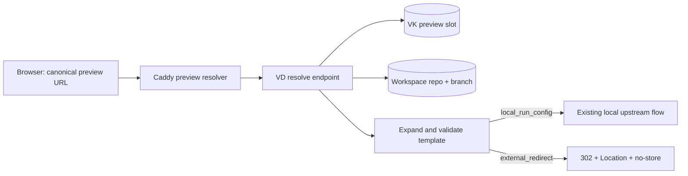

# External preview redirects

## Goal

Let a Preview Slot keep its canonical Vibe Dashboard URL while redirecting to
an externally hosted preview derived from the slot's repository and the current
workspace branch. The model is provider-neutral and never executes a script.

## Assumptions

- Redirect targets are configured by a trusted workspace administrator, as run
  configs are today. Browser callers may select an existing slot but may not
  supply a template or destination.
- The repository's workspace branch is the branch source of truth. A detached
  or missing branch makes the redirect unavailable.
- V1 permits only HTTPS destinations. Supporting HTTP for loopback development
  is a separate local-only feature.
- Redirects use `302 Found` and `Cache-Control: no-store`, because a workspace
  branch or slot configuration can change without changing the canonical URL.

## Requirements

1. A slot targets exactly one of a local run config or an external redirect.
2. Templates use a fixed variable allowlist and produce an absolute HTTPS URL.
3. The server computes destinations from stored configuration and authoritative
   workspace/repository data at request time.
4. Validation and dry-run return metadata and a destination URL, never secrets.
5. Existing local slots and canonical hostnames remain unchanged.

## Design



The existing resolver remains the only decision point. Caddy adds one terminal
result, `redirect`, alongside `ready`, `starting`, and the existing error
states. It does not expand templates itself.

### Stored model

Replace the mandatory `run_config_id` relationship with a tagged target:

```text
PreviewSlotTarget =
  | { type: "local_run_config", runConfigId: UUID }
  | { type: "external_redirect", urlTemplate: string,
      projectSlug?: string, allowedHostTemplate: string }
```

Persist this with explicit columns rather than a JSON blob:

```text
preview_slots.target_type                 NOT NULL
preview_slots.run_config_id               NULLABLE
preview_slots.external_url_template       NULLABLE
preview_slots.external_project_slug       NULLABLE
preview_slots.external_allowed_host_template NULLABLE
```

A database check constraint enforces the union: local rows require only
`run_config_id`; external rows require only `external_url_template`. The
external fields are null for local rows. Migration marks every existing row as
`local_run_config` without changing its ID or slug.

### Template language

Only literal text and these exact placeholders are accepted:

| Variable | Value | Normalization |
| --- | --- | --- |
| `{branch}` | Workspace branch | Percent-encoded as one URL component |
| `{branchSlug}` | Workspace branch | Lowercase; non-alphanumeric runs become `-`; trim `-`; max 63 |
| `{repoSlug}` | Existing Preview URL repo slug | Already validated lowercase alphanumeric |
| `{repoName}` | Repository display name | Percent-encoded as one URL component |
| `{workspaceToken}` | Existing 16-hex token | Already validated |
| `{customerSlug}` | Configured URL customer | Existing validation |
| `{projectSlug}` | Slot configuration | Lowercase letters, digits, and single dashes; max 63 |

Unknown placeholders, an empty normalized value, user-info, fragments, and
non-HTTPS schemes fail validation. Expansion is direct placeholder replacement,
not a general expression language. Each value is encoded before insertion;
templates cannot request raw values.

After expansion, parse with the standard URL parser and require:

- scheme is `https`;
- hostname exactly matches the separately expanded `allowedHostTemplate`;
- no username or password;
- port is absent or `443`;
- serialized URL is at most 2,048 bytes.

The host template may contain only `{branchSlug}`, `{repoSlug}`,
`{workspaceToken}`, `{customerSlug}`, and `{projectSlug}`. Literal host-template
text is limited to lowercase letters, digits, dots, and dashes. Every expanded
label must pass DNS label validation and the complete hostname must stay within
253 bytes. `{branch}`, `{repoName}`, ports, and other URL syntax are rejected.
Host allowlisting is mandatory even when the URL template contains a literal
host. This prevents a path/template edit from changing the redirect authority
and prevents branch text from escaping a DNS label. DNS resolution and outbound
fetching are not needed: the server only returns a redirect.

### Provider examples

Presets are UI/CLI input shorthands that compile to the same template and host
allowlist fields. They are not stored as provider-specific execution modes.

```text
Cloudflare Pages
  https://{branchSlug}.{projectSlug}.pages.dev
  allowedHostTemplate: {branchSlug}.{projectSlug}.pages.dev

Vercel custom preview alias
  https://{projectSlug}-git-{branchSlug}.example-vercel-domain.com
  allowedHostTemplate: {projectSlug}-git-{branchSlug}.example-vercel-domain.com

Netlify branch subdomain
  https://{branchSlug}--{projectSlug}.netlify.app
  allowedHostTemplate: {branchSlug}--{projectSlug}.netlify.app
```

Presets only fill these two generic fields and select the documented branch-slug
rule. They do not add provider runtime code. Do not add a wildcard matcher.

### API and CLI

Keep the current slot upsert endpoint and add the tagged `target` object. An
omitted target remains invalid; old clients sending `run_config_id` are decoded
as `local_run_config` during one compatibility window.

Add one side-effect-free operation:

```text
POST /workspaces/{workspaceId}/execution/preview-slots/validate-target
```

It accepts the same external target fields plus `repo_id`, resolves the current
branch, and returns `{ valid, destination?, errors[] }`. Upsert runs the same
validation. The global `vk` CLI exposes this as `preview-slots target preview`
and sends exactly the API payload; it does not duplicate expansion logic.

The UI uses the dry-run response before save and displays the computed host,
branch input, and validation errors. Audit events record target type, template,
allowed host template, and computed destination host, but never query values that may
contain credentials. Templates containing URL query parameters are rejected in
V1 to keep that boundary simple.

### Resolver response

```json
{
  "status": "redirect",
  "location": "https://feature-login--dashboard.netlify.app/",
  "workspaceId": "...",
  "previewSlotId": "..."
}
```

Caddy accepts `location` only from the authenticated local resolver, parses it
again, requires HTTPS, and sends `302`, `Location`, and `Cache-Control: no-store`.
Missing branch metadata returns `failed` with a safe message; it never falls
back to a provider's production URL. Asset and WebSocket requests receive the
same redirect because the external service owns routing after the browser moves.

## Build plan

1. Add the target columns, constraint, allowlist table, migration, model types,
   and model tests. Migrate existing slots unchanged as local targets.
2. Add the small template parser/expander and table-driven tests for every
   variable, encoding, branch normalization, length, malformed URLs, and host
   escape attempts.
3. Add target validation/dry-run and upsert compatibility tests.
4. Return `redirect` from the existing resolver and add Caddy response tests for
   status, headers, missing metadata, and malicious locations.
5. Add CLI and UI target editing only after the server path passes end-to-end.
6. Test existing local start/log/stop/restart behavior unchanged, then test all
   three provider examples against deterministic fake workspace metadata.

## Concerns and expansions

- Provider APIs that discover deployment URLs are out of scope; they require
  credentials, network calls, retry policy, and provider-specific state.
- Wildcard destination hosts are out of scope until a concrete provider cannot
  be represented by constrained variable labels.
- Permanent redirects and caching are out of scope because branch mappings are
  mutable.
- Query parameters are out of scope until audit redaction and secret handling
  have an explicit contract.
