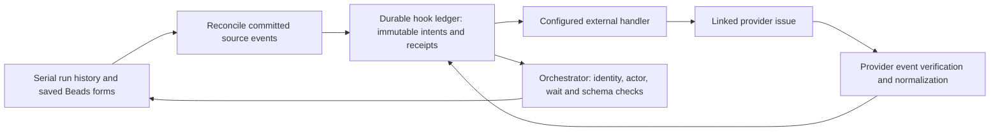

# Bidirectional external issue hooks

## Goal

Design successor integration between a linked external issue and Beads/serial
workflows: publish form creation, accepted submissions, and major status changes;
ingest explicitly configured external decisions and status updates. This document
is the design deliverable for `vkvw-h9ogn`, not an enabled integration. The current
message contracts are documented in [serial workflows](serial-workflows.md).

## Assumptions

The first implementation binds one external issue to a workspace and its workflow
runs. A run snapshots that binding; grouped beads retain their existing identities.
Unlinked workspaces do not emit events. Provider selection and installation are
successor work; examples below describe a provider-neutral record, not supported
YAML keys. The default inbound policy accepts no external decisions until explicit
provider-user mappings are configured. These defaults can be revised before the
implementation is selected.

## Requirements

- Form creation and accepted submissions can create comments on the linked issue;
  major workflow status changes can update explicitly mapped external fields.
- External decisions retain exact run/item/revision/dispatch/wait/form correlation
  and must satisfy the snapshotted authority and item result schema.
- Events, payloads, and receipts survive restart. Replays cannot duplicate remote
  effects or advance a workflow twice; uncertain writes require reconciliation.
- Bidirectional status and comment traffic must not create feedback loops.
- Provider-specific interpretation belongs at a configured handler/adapter boundary,
  not in role prompts or an alternate workflow-result protocol.

## Design



The orchestrator remains the only workflow transition writer. The hook ledger
handles external delivery, not coding-agent admission; an external event never
calls direct follow-up or bypasses the identified VK queue.

### Binding and event identity

A proposed binding contains `binding_id`, `binding_version`, `workspace_id`,
`handler_id`, and `issue: {provider, instance_id, project_id, issue_id}`. The URL is
display-only, not identity. Configuration also holds enabled event kinds, allowed
provider user IDs, and explicit external-status mappings. Secrets stay in the
provider handler's environment, outside event payloads and Beads metadata. Persist
only the binding reference and issue identity with the run/associated Beads record.

Snapshot the binding version, actor/status mappings, and destination in every
outgoing intent and published wait. These are proposed ledger records, not new
fields silently accepted by current strict run snapshots. Changing a
binding cannot redirect an uncertain write. A pending external decision retains
its published binding; rebinding it requires an audited wait reissue, just as an
authority change does. No workspace/issue association is inferred from comment
text or an arbitrary URL.

An outgoing event has `format_version: 1`, `event_id`, `kind`, `binding_id`,
`binding_version`, the issue identity, full correlation, `source_id`, `origin`,
`causation_id`, and a minimal structured payload. For example:

```json
{
  "format_version": 1,
  "event_id": "sha256:<canonical event identity hash>",
  "kind": "form.created",
  "binding_id": "workspace-issue",
  "binding_version": 1,
  "issue": {"provider": "selected-provider", "instance_id": "instance", "project_id": "project", "issue_id": "42"},
  "correlation": {"workspace_id": "workspace", "run_id": "run", "item_id": "review", "revision": 2, "dispatch_id": "dispatch", "wait_id": "wait", "form_id": "workflow_wait", "bead_id": "task-123"},
  "source_id": "run:wait:attached",
  "origin": "vd",
  "causation_id": null,
  "payload": {"question": "Approve the change?", "allowed_outcomes": ["approved", "changes_requested"]}
}
```

Compute `event_id` from canonical JSON of namespace/version, binding ID/version,
kind, and immutable source identity. Hash the entire frozen payload separately;
the same event ID with different content is a conflict, not a new attempt.
Timestamps, delivery attempts, and current configuration are not event identity.

| Kind | Durable source and publication rule |
| --- | --- |
| `form.created` | Run/wait/form identity, only after saved attachment is confirmed; lost attachment responses reconcile by reading that same form. |
| `form.submitted` | Accepted `form_answer` history sequence and submission identity; publish the validated decision and actor provenance, not unvalidated drafts. |
| `authority.updated` | Audited run history sequence; indicate that the old form is superseded. |
| `workflow.status_changed` | Run history sequence at an actual major status/item/revision change; omit polling and repeated unchanged projections. |

The full immutable source record is retained until its intent has been recorded.
Reconcile history and confirmed form attachments after restart; do not rely on an
in-memory callback firing between mutation and event creation. Missing source or
conflicting definition becomes delivery attention, not a fabricated event.

### Outgoing handler and delivery receipts

Use one locked, atomically persisted hook ledger in existing VD runtime storage,
with outgoing intents and incoming receipts indexed by event identity. Persist an
outgoing intent before invoking a handler; claim it atomically so concurrent
workers cannot send it twice. Track `pending`, `in_flight`, `delivered`, and
`needs_attention`, attempts, retry time, payload hash, and accepted remote object
ID/version. Recovery treats an interrupted `in_flight` write as uncertain.

The proposed handler invocation receives the frozen event and attempt identity on
stdin and returns a structured receipt with event ID, payload hash, remote issue
and effect ID/version. Reconcile against the same destination before accepting a
receipt. A provider idempotency key uses the event ID. If unavailable, the adapter
must support exact lookup of its event marker and matching payload/effect; otherwise
an uncertain write needs attention rather than an automatic second comment.
This is at-most-one verified effect where the provider supports reconciliation,
not an unconditional exactly-once network guarantee.

Retry proven retryable failures with the same event/body, bounded exponential
backoff, and provider `Retry-After`. Reconcile timeouts or lost responses before
retrying writes. Permanent rejection or conflicting remote content stays visible
with its event ID; an explicit retry preserves that identity. Hook failures do
not roll back accepted workflow decisions or block unrelated coding work.

The current `workflow-handlers.ts` command boundary is reusable, but its generic
exit-code log is insufficient: it discards stdout and leaves interrupted handlers
indeterminate. Successor work must add the structured receipt/reconciliation
contract and atomic claims before enabling external writes. Current coordinator
XML may select a configured `run_handler` under existing role/message permissions;
serial form/status events originate from committed orchestration state. Do not add
provider action tags, assume generic `run_handler` success proves a remote effect,
or use its trigger/handler key as the identity of several distinct form events.

For example, the existing YAML handler declaration shape is:

```yaml
handlers:
  external_issue:
    enabled: true
    command: ["/path/to/selected-issue-adapter"]
    timeout_ms: 30000
```

The command is an implementation placeholder. A permitted coordinator envelope
could include the following JSON actions, provided `review_change` targets the
configured reviewer and allows `run_handler`:

```json
{"outcome":"delegated","actions":[{"type":"send_message","role":"reviewer","message_type":"review_change"},{"type":"run_handler","handler_id":"external_issue"}]}
```

The surrounding XML metadata remains the initiating checkpoint's schema identity.
Currently this invokes only the generic handler with its existing payload; it does
not supply the proposed hook event/receipt contract. The successor adapter must
resolve committed source events and use the hook ledger before updating an issue.

### Incoming decisions and status

The provider adapter verifies webhook authenticity, installation/instance, exact
issue identity, event type, immutable provider user ID, and stable provider event
identity before storing a normalized incoming intent. An adapter without a stable
event identity must define an object-ID/version equivalent before activation.
Store transport delivery IDs for diagnostics; retries with new delivery IDs still
map to the same underlying event. Conflicting payload hashes are rejected.

For a form decision, normalize only an explicitly supported structured submission
or mapped decision action into the eight-field decision envelope taught in the
decision message. Arbitrary comments, issue closure, labels, and display names
cannot authorize approval. Store original provider event/object revision, verified
actor ID, binding version, payload hash, and correlation as immutable provenance.

The orchestrator requires a current waiting run, matching published issue/binding,
exact run/item/revision/dispatch/wait/form identities, a configured actor mapping,
human authority for a mapped external human, one allowed non-wait outcome, and a
schema-valid six-field item projection. An external human cannot answer for a
snapshotted decision-maker process or change authority implicitly. Reject edits or
deletions of accepted submissions; a correction requires a new current wait.

Persist the normalized command intent and provenance before applying it through
the existing version-checked reducer. Use an idempotency key derived from the
binding/provider event ID, and a submission ID that references that provenance.
Do not counterfeit a saved Beads `submittedBy: user` response or expose a free-form
actor override. This is a new trusted ingestion boundary requiring explicit
implementation; current form polling does not consume external submissions.
After a crash between mutation and receipt, reconcile the run's existing command
receipt/hash instead of applying a second answer. A version conflict requires
rechecking the same current wait; never remap an old answer to a replacement wait.

External status synchronization updates only configured informational Beads
metadata, with provider revision ordering and a receipt. Closing an external issue
does not complete a serial item or close grouped beads. Workflow advancement still
requires an authorized correlated decision; unrecognized events receive an ignored
receipt without a workflow mutation.

### Loop prevention

Every applied inbound command retains its external event as causation in the
ledger. Suppress outward mirroring of that effect to the same binding; locally
originated decisions/status changes remain publishable. Ignore provider echoes
only when the configured integration actor and remote object/event marker match a
known outgoing receipt. An arbitrary user's copied marker is not trusted origin
or authorization. Repeated webhook delivery, attachment retries, and Beads
projection refreshes reuse source identities rather than generating new events.

## Build plan

Implement the shared ledger and normalization/receipt contract first, then select
one provider adapter with explicit issue bindings and actor mappings. Add outgoing
projection from durable run/form sources and the incoming gateway through the
existing reducer; expose event state and explicit same-ID retry in Beads/status.
Keep ordinary role schemas and VK admission unchanged.

Acceptance must exercise: duplicate/out-of-order events; same ID/different body;
concurrent claims; restart before send and after remote acceptance but before
receipt; unsupported uncertain-write reconciliation; form attachment response loss;
stale wait/revision and authority reissue; disallowed actors and unrelated issues;
issue closure without approval; repeated accepted decisions; bot echoes; and one
local form -> external comment -> authorized external answer -> one workflow
transition round trip. Assert remote effect IDs and reducer receipts/cardinality.

## Concerns & expansions

Provider credentials, webhook transport, and adapter selection need a separately
selected implementation bead. Provider capabilities determine whether uncertain
effects can be reconciled automatically. Multiple issue bindings, cross-provider
fan-out, arbitrary comment commands, and edits of accepted history add routing or
conflict semantics and are outside this first design.
