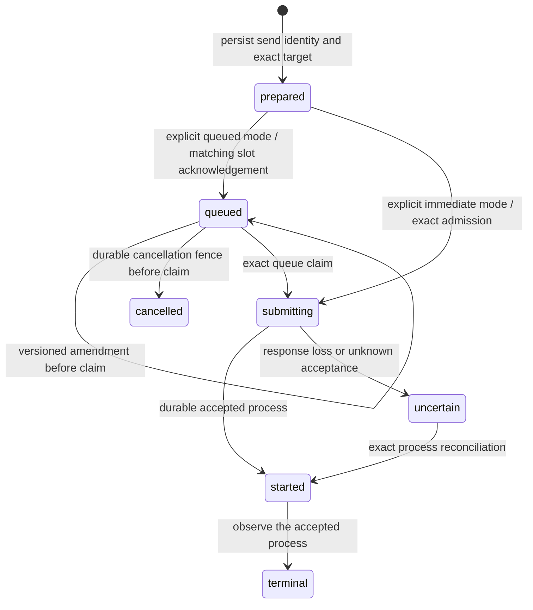

# Sender-facing message correction and undo

## Goal

The remaining `vkvw-fsdxo` implementation gives senders explicit immediate/queued
choices, inspection by stable send identity, and queued-only amendment/cancellation.
An accepted process remains immutable. This is a design for the next implementation,
not a declaration that the commands below are available today. Admission and
adapter acceptance remain prerequisites.

## Assumptions

Use the existing trusted local CLI context and one VK pending slot per target
session. No additional user-facing FIFO is introduced. Preserve default response
routing and `--fire-and-forget`; queued delivery requires the daemon to reconcile
idle starts and restart. A correction after acceptance is a new explicitly chosen
send, not a rewrite or an implicit interrupt. These defaults follow the recorded
branch plan and can be revised before implementation.

## Requirements

- Immediate mode either starts through atomic admission or reports busy/conflict;
  it does not silently fall back to queueing.
- Queued mode returns a stable receipt, even when no process exists yet. It never
  replaces another owner's slot or guesses acceptance from timestamps.
- Only the exact still-editable queued intent can be amended or cancelled.
  Consumption, durable reservation, accepted process, and uncertain start are
  separate visible states, never presented as successful undo.
- Lost responses, delayed older requests, and restart cannot resurrect a cancelled
  intent or overwrite a newer amendment. Response routing follows the accepted
  process exactly once.

## Design



Cancelled identity stays fenced after the local receipt or in-memory slot is lost.
Uncertain work remains the same identity; absence alone cannot authorize a new
send. A pre-start failure permits only the existing same-ID retry contract.

### Proposed CLI and receipts

```sh
# Existing send behavior remains immediate; explicit spelling is also available.
vibe-agent send --mode immediate reviewer "Review the implementation" --json
vibe-agent send --mode queued reviewer "Review the corrected implementation" --json

vibe-agent message status SEND_UUID --json
vibe-agent message amend SEND_UUID --expected-version 1 \
  --idempotency-key edit-1 --message-file corrected.txt --json
vibe-agent message cancel SEND_UUID --expected-version 2 \
  --idempotency-key cancel-1 --json
```

Support the existing literal/stdin/message-file input choices. Mutating replay
uses a caller-supplied idempotency key and returns its original receipt before
checking a now-stale version. The initial send accepts a caller-selected send UUID
for safe retry; otherwise print/persist the generated identity before submission
can become uncertain. Unknown delivery modes fail before send I/O.

Persist a versioned receipt with workspace ID, send UUID (= VK queue UUID), owner,
target session/executor, exact requested message, response-route preference/reply
session, payload hash, mutation receipts, delivery state, and accepted process ID
when known. Resolve a role once; later role-registry changes cannot retarget a retry.
Fresh-session creation, when required, uses the existing immutable identified
session tuple. The owner namespace is `user-send:<sender-session-id>`; generic user
commands cannot amend workflow/CI-owned intents.

JSON distinguishes `queued`, `submitting`, `started`, `uncertain`, `cancelled`, and
`failed_before_start`; include send/session/owner/version in every receipt. Include
`process_id` only after exact acceptance. Status exposes whether amendment/undo is
currently permitted and why it is not. It uses REST queue/effect/process evidence,
not a new WebSocket or a text-only claim that a message was delivered.

An immediate send racing with another start must return a truthful busy outcome
without leaving automatically runnable queued work. Implement that through the
common atomic admission boundary; a read-idle-then-enqueue/start sequence alone
cannot promise immediate semantics. If admission is uncertain, return the saved
identity for reconciliation instead of retrying through direct follow-up.

### Amendment, cancellation, and the consumption boundary

Preserve stable send/queue identity through amendments **only before any durable
start reservation**. Require owner, expected payload version/hash and idempotency
key; atomically compare them against the same queued slot that consumption claims.
Update the requested data and displayed fingerprint together. A delayed start
carrying the previous body must conflict, not bind a different process.

Cancellation must commit a durable terminal fence before acknowledging success.
Every enqueue/start/reconstruction path consults it, so a delayed original POST
cannot recreate cancelled work after slot loss or restart. An old amendment cannot
remove a cancellation fence. Avoid replacing the queue UUID to evade a reservation;
the reviewed adapter permits a new transport identity only after an old identity
is durably closed against delayed requests.

If consumption/reservation wins first, return `too_late` with exact identity and
available lifecycle/process evidence. Do not stop the process, remove a consuming
slot, amend an accepted payload, or turn an unresolved effect into cancellation.
Any termination request belongs to the separately designed reserved interrupt
flow, never an automatic fallback from `message cancel`.

### Current source gaps the implementation must resolve

`legacy-cli/vibe-agent.ts` currently sends immediately with an advisory idle check
and direct follow-up. It has no delivery-mode or public message-management command.
The new UX must use matching atomic admission, not promote that check into an
overlap guarantee. An unsupported backend must fail visibly before coding work.

`nudge/send-queue.ts` is a different, local daemon queue with its own file lock and
`sending`/`indeterminate` states. Its amend/cancel methods are not a durable VK
cancel fence. Do not expose it as if it were the authoritative VK slot or silently
add another user backlog behind an occupied slot.

VK's current `QueuedMessageService::cancel_queued` removes an in-memory slot, and
`amend_queued` checks the slot's `consuming` flag. Those operations alone do not
provide the new restart/delayed-request guarantees. Amendment also needs to keep
the serialized requested fingerprint consistent with edited data; current start
paths recompute the fingerprint rather than trusting that display field. If a
`failed_before_start` effect already binds the old fingerprint, an edit cannot
quietly change it: reject the edit and retain same-payload retry semantics.

The implementation therefore needs a reviewed durable mutation/version fence
coordinated with exact claim/admission, plus corresponding forward migration and
CI-generated API changes if its public types change. Do not claim the richer undo
contract by merely adding CLI wrappers around the current in-memory methods.

### Response routing and correction after acceptance

Default queued sends require response-scanner readiness before accepting new work;
persist reply context without starting its response lifetime at enqueue time.
Bind the route only to the exact accepted process. Cancellation before acceptance
must leave no response delivery behind. Amendment changes the queued prompt, not
the recipient or reply context; retargeting requires a separate send.

After acceptance, status prints the process ID and explains that undo is too late.
The sender may then send a message explicitly referencing the earlier process as
a correction, choosing immediate mode after termination or queued mode behind the
active turn. Both use normal admission. This creates a new identity and preserves
the original receipt/history; it does not assert the earlier agent forgot its work.

## Build plan

Review the durable mutation fence alongside queue claim/start before changing CLI
dispatch. Implement the VK compare-and-mutate/fence boundary and status contract,
then durable local send receipts and response-route binding, then the proposed
CLI/help/docs. Retain existing workflow-owned immutable dispatch behavior.

Acceptance must force amend-vs-claim, cancel-vs-claim, delayed enqueue after cancel,
delayed old-body start after amend, response loss after each acknowledgement,
restart with slot loss, stale versions/keys, unrelated owner/slot conflicts,
same-ID failed-before-start retry, immediate busy without queued side effects,
and accepted-process correction. Assert exact process/cardinality and route IDs,
not only success strings. Keep the feature open until admission/adapter gates and
these implementation checks pass.

## Concerns

The durable fence is additional implementation work beyond the already tested
minimal in-memory queued-only primitives. It must be scoped and reviewed before
exposing stronger sender promises. There is no generic history editing, implicit
force-send, FIFO expansion, or automatic stop/recovery in this design.
