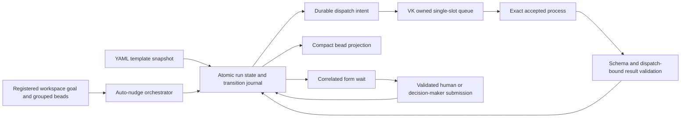

# Serial workflow implementation

## Goal

Extend the validated auto-nudge transport foundation with one durable, serial
implementer → code reviewer → tester workflow. Rejection resets existing items
to a configured earlier item and increments the revision. A restart must neither
lose pending work nor duplicate an accepted turn.

Scope source: `vkvw-rjpj2`, processed `task-86i` forms, `task-m9b`, `task-d8z`.
The user authorized plan/review followed by implementation on 2026-10-22.

## Assumptions

Runtime state is local to the VD instance, using the existing persisted runtime
directory. One orchestrator is the transition writer; separate CLI invocations
still require a filesystem lock and expected-version checks. Changing workspace
form authority applies to new runs; existing runs retain a snapshot of authority.
This default prevents an active human wait silently becoming agent-authorized.

## Requirements

1. Auto-nudge selects serial runs from registered workspace goal/nudge context.
   A run records an explicit group of related bead IDs; no one-run-per-bead rule.
2. YAML templates have stable item IDs, roles, prompts, result contracts and
   outcome-specific `resets_to` references to earlier items. No phase taxonomy.
3. A run stores template ID/version/hash/full normalized snapshot, one current
   item, revision, state version, and append-only transition history.
4. Results bind run/item/revision/dispatch identity and schema identity. Only
   the current accepted dispatch may advance. Stale results never mutate state.
5. Rejection preserves history, increments revision, resets the target and all
   later items, and invalidates their prior approvals. Earlier completed items
   are explicitly carried forward in history. Retry cannot resend uncertain work.
6. Durable delivery intent precedes VK queue calls. Queue identity/owner/payload
   are stable. Occupied slots are preserved. Only proven unaccepted work may be
   recreated after VK's in-memory queue disappears. Accepted/uncertain intent
   reconciles by exact identity and cannot be blindly retried.
7. Forms bind run/item/revision/form/dispatch. Workspace configuration chooses
   human or one configured decision-maker session. Agents use the same task and
   result contract regardless of authority. Duplicate decisions cannot advance
   twice. Authority comes from the validated submission boundary, not payload text.
8. Bead metadata contains only run ID/status/revision/current ID+label, plus the
   latest 10 compact major transition events. Runtime owns operational identities.
9. Explicit interrupt reserves admission across stop/wait/start and conflicts
   with an occupied queue without replacing it. Unconfirmed termination stays
   needs-attention. Ordinary cancellation is not a recovery signal.

## Design



Keep workflow runtime modules beside `scripts/vibe-agent/nudge/`. The existing
`packages/workflow-core` runs unrelated in-memory functions and lacks the required
durable state/turn identities; adapting it would add coupling without reuse.

### State and mutation boundary

Use one atomic JSON snapshot per run and a lock covering read/version-check/
transition/write. State contains the complete transition history and pending
projection events; a derived append-only JSONL journal is reconciled by sequence
number. The snapshot is authoritative if a crash occurs between writes. A
replayed idempotency key must match the original command payload before returning
its recorded result. Check idempotency before expected-version so a legitimate
retry can return after the original command advanced the version.

`workflow create/status/start/submit-result/retry/cancel` are narrow orchestrator
operations. Role agents return structured results; they do not edit run state.
CLI mutations require expected version and idempotency key. The daemon uses the
same mutation functions under its existing owner lock. Projection is a retryable
effect, not authority for completing a run.

Dispatch identity includes run/item/revision/attempt. Persist its exact queue
identity and payload before delivery. A retry after a *proven* pre-admission
failure allocates a new attempt; an uncertain attempt blocks retry. Completion
requires a result from the exact accepted process, not role name or timestamp.

### Template and result example

The template section is a new config contract, not valid existing v2 YAML.
Introduce it with an explicit version and strict validation; preserve current
checkpoint configuration until its audited replacement is tested.

```yaml
templates:
  reviewed_change:
    version: 1
    items:
      - id: implement
        role: implementer
        prompt_id: implement_change
        outcomes: [complete, blocked, waiting]
      - id: review
        role: reviewer
        prompt_id: review_change
        outcomes: [approved, changes_requested, blocked, waiting]
        resets_to: {changes_requested: implement}
      - id: test
        role: tester
        prompt_id: test_change
        outcomes: [passed, failed, blocked, waiting]
        resets_to: {failed: implement}
```

Every dispatch teaches its role-specific authoritative schema ID/version/hash,
exact required correlation values, and an example. Ordinary prose and missing
final results cannot advance. A successful process exit without a valid result
becomes needs-attention. It does not authorize automatic continuation.

### Forms and configuration changes

Persist the wait before attaching its form. Reconcile attachment by stable form
identity. Resume only with a trusted persisted submission from the configured
actor and matching correlation. Snapshot workspace authority at run creation;
changing it for an active run requires an explicit future audited operation.
Keep the same role prompt/result shape for human and decision-maker waits.

## Build plan

1. Review this plan against production admission, queue and form boundaries.
2. Implement durable runtime and strict template/result validation first, with
   crash-recovery, version/idempotency, reset/revision and stale-result tests.
3. Integrate narrow CLI commands and daemon orchestration, then VK-owned queue
   delivery/reconciliation. Persist intent before I/O and exact acceptance before
   observing outcomes. Add serial workspace scheduling and bead projections.
4. Integrate correlated forms and authority snapshots. Add interrupt reservation
   at the VK boundary before exposing workflow interrupt.
5. Finish message-specific protocol onboarding (`task-m9b`) and remove the
   agent response-wait watcher (`task-8jf`) while preserving callback execution
   deadlines and separate script `vk send --sync` semantics.
6. Exercise matching real VK/VD in CI (`task-d8z`): full serial success, reviewer
   rejection, tester reset, stale approval rejection, queue loss/restart before
   and after acceptance, occupied-slot nonreplacement, form wait/restart/resume,
   duplicate decisions, and interrupt/callback races. Retain the current 14-test
   QA gate and aggregate/no-WebSocket coverage. Run focused checks per slice,
   type checks, implementation review and current-head remote gates.

## Concerns and expansions

VK abnormal-interruption recovery remains separately reviewed `task-yiu` work.
The workflow marks clean missing-result exits needs-attention; it must not add a
second recovery owner. Generic FIFO, role fan-out, rich correction CLI, external
provider adapters and a visual editor remain outside this serial slice.
